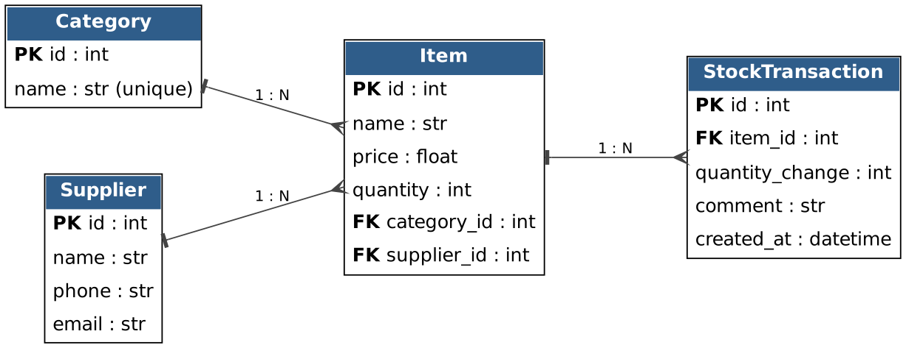

# Информационная система: «Склад» — учёт товаров на складе

**Курс:** Прикладное программное обеспечение информационных систем (2026 г.)
**Автор:** Студент группы [Номер группы] — [ФИО]

## 1. Описание предметной области

Система автоматизирует учёт товаров на складе: ведётся каталог товаров с
ценами и остатками, товары группируются по категориям и привязываются к
поставщикам, а каждое изменение остатка фиксируется в журнале транзакций.
Пользователь — кладовщик или менеджер склада: он просматривает и ищет товары,
добавляет новые позиции, редактирует и удаляет их.

## 2. Архитектура данных (ER-диаграмма)



* Таблица `Category` — категории товаров. Связь «один-ко-многим» с `Item`.
* Таблица `Supplier` — поставщики. Связь «один-ко-многим» с `Item`.
* Таблица `Item` — товары (название, цена, остаток); внешние ключи на `Category` и `Supplier`.
* Таблица `StockTransaction` — журнал изменений остатков. Каждая запись принадлежит одному `Item`.

## 3. Технологический стек

* **Backend:** Python 3.11+, FastAPI, Uvicorn
* **Database / ORM:** SQLite, SQLModel (SQLAlchemy)
* **Frontend UI:** Streamlit, Requests
* **AI-tools:** Cursor IDE (генерация шаблонов, ревью кода)

## 4. Локальный запуск

```bash
python -m venv venv
venv\Scripts\activate        # Windows  (Mac/Linux: source venv/bin/activate)
pip install -r requirements.txt

python seed.py                          # создать БД и тестовые данные
uvicorn app.main:app --reload           # терминал 1: бэкенд  -> http://127.0.0.1:8000/docs
streamlit run app/frontend/ui.py        # терминал 2: интерфейс -> http://localhost:8501
```

## 5. API

| Метод | Путь | Описание |
|-------|------|----------|
| GET | `/items` | Список товаров. Фильтры: `search`, `min_price`, `max_price`, `category_id` |
| GET | `/items/{id}` | Товар по ID (404, если нет) |
| POST | `/items` | Создать товар (201; 422 при неверных данных) |
| PATCH | `/items/{id}` | Частично обновить товар |
| DELETE | `/items/{id}` | Удалить товар |
| GET | `/categories` | Список категорий |
